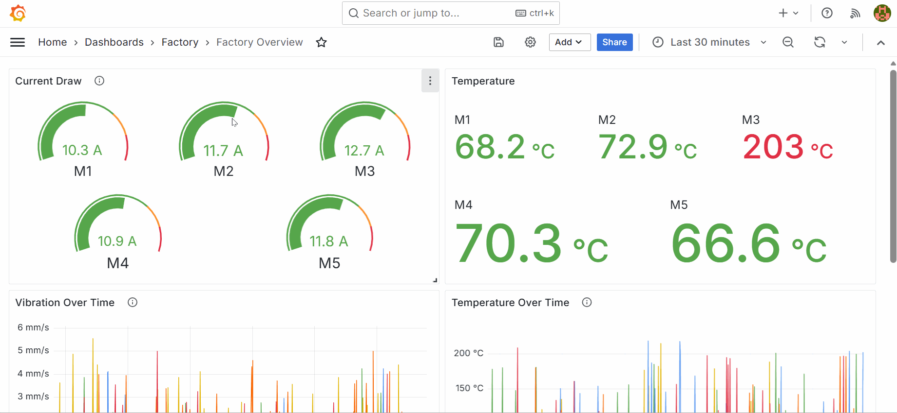
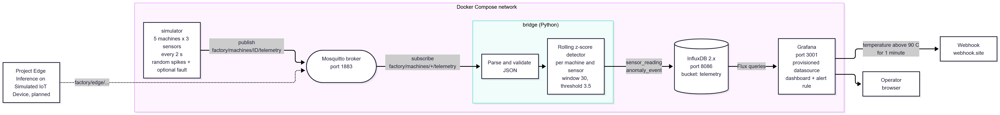

# Industrial IoT Data Pipeline



[](https://github.com/winimoid/industrial-iot-pipeline/actions)
[]()
[]()
[]()
[]()
[]()

> A complete IoT data pipeline for a simulated factory floor: five machines stream sensor data over MQTT, the data is stored in InfluxDB, anomalies are flagged in real time, and everything is visualised in Grafana. The whole stack starts with a single `docker compose up`.

## Features

- **Simulates** 5 machines with 3 sensors each (temperature, vibration, motor current), publishing every 2 seconds with Gaussian noise, random spikes and an optional sustained-overheating fault.
- **Streams** telemetry through a Mosquitto broker using a `factory/machines/<id>/telemetry` topic hierarchy.
- **Stores** readings and anomaly events in InfluxDB 2.x, tagged by `machine_id` for fast per-machine queries.
- **Detects** anomalies in real time with a rolling z-score per machine and sensor, tuned with a measured precision/recall.
- **Visualises** live health in Grafana: colour-coded temperature tiles, time series, current-draw gauges and an anomaly event log.
- **Alerts** through Grafana when a machine stays above 90 °C for more than one minute, delivered to a webhook.
- **Reproduces** anywhere: the data source and the dashboard are provisioned from files and the tests run in GitHub Actions on every push.

## Architecture

The stack is made of five containers on one Docker Compose network:



| Component | Role | Produces | Consumed by |
|---|---|---|---|
| `simulator` | Generates machine telemetry | JSON on `factory/machines/<id>/telemetry` | Mosquitto |
| `mosquitto` | Publish/subscribe broker (port 1883) | n/a | bridge |
| `bridge` | Parses, validates, detects anomalies, writes | `sensor_reading`, `anomaly_event` | InfluxDB |
| `influxdb` | Time-series store (port 8086) | Flux query results | Grafana |
| `grafana` | Dashboard and alert rule (port 3001) | Webhook notification | Operator |

### Data flow

1. The simulator publishes one JSON message per machine every 2 seconds to `factory/machines/<id>/telemetry`.
2. Mosquitto fans the messages out to every subscriber. Publishers and subscribers never talk to each other directly, which is what lets the edge device of a later project join without changing anything.
3. The bridge subscribes to `factory/machines/#`, validates each message (bad JSON, missing values and NaN are skipped, not fatal) and passes each sensor value through the anomaly detector.
4. Each message becomes one `sensor_reading` point; every detected anomaly adds an `anomaly_event` point. Both are written to InfluxDB in a single call.
5. Grafana queries InfluxDB with Flux. Its data source is provisioned with a fixed UID, so the exported dashboard works on any fresh install.

### Message format

```json
{
  "machine_id": "M1",
  "timestamp": "2026-11-08T14:23:01.432+00:00",
  "sensors": {"temperature_c": 72.4, "vibration_mm_s": 1.8, "current_a": 12.1},
  "injected_anomaly": false,
  "injected_sensor": null
}
```

`injected_anomaly` and `injected_sensor` are the simulator's ground truth. The detector never see them but they are stored with each anomaly event and are what makes the precision/ recall evaluation below possible.

### InfluxDB data model

| Measurement | Tags | Fields |
|---|---|---|
| `sensor_reading` | `machine_id` | `temperature_c`, `vibration_mm_s`, `current_a` |
| `anomaly_event` | `machine_id`, `sensor` | `value`, `expected_mean`, `expected_std`, `z_score`, `injected` |

## Quick start

```bash
git clone https://github.com/winimoid/industrial-iot-pipeline
cd industrial-iot-pipeline
docker compose up --build
```

| Service | URL | Login |
|---|---|---|
| Grafana | http://localhost:3000 | admin / admin |
| InfluxDB | http://localhost:8086 | see `.env.example` |
| MQTT broker | `localhost:1883` | anonymous |

Live data shows up in the dashboard within about 30 seconds. The defaults in `docker-compose.yml` are for local development only so copy `.env.example` to `.env` to change credentials. To wipe all stored data, run `docker compose down -v`.

### Trigger the overheating alert

Random spikes last one 2-second reading, so they can never satisfy a "above 90 °C for 1 minute" rule. For the alert demo the simulator has a sustained fault mode. In `docker-compose.yml`, uncomment the `command` line of the `simulator` service:

```yaml
command: ["python", "-u", "sensor_sim.py", "--fault-machine", "M3"]
```

M3 then runs at about 100 °C for 150 seconds in every 10-minute cycle. The first fault begins roughly 7.5 minutes after start, the alert goes Pending, then Firing after one minute, and the webhook receives a POST.

## Dashboard

| Panel | Shows |
|---|---|
| Stat tiles | Current temperature per machine: green below 80 °C, amber from 80, red from 90 |
| Time series | Temperature and vibration over the last 30 minutes, one line per machine |
| Gauges | Current draw per machine |
| Table | The 20 most recent anomaly events with value, expected mean and z-score |

The Flux query behind each panel and the alert rule setup are in [`docs/grafana_panels_flux.md`](docs/grafana_panels_flux.md). The alert rule is created in the Grafana UI following that guide; it is not part of the exported dashboard JSON.

## Anomaly detection

For every (machine, sensor) pair the bridge keeps the last `N` readings. A new value is compared with the **previous** window: its z-score is `|x - mean| / stdeviation`, it is flagged when the score exceeds the threshold, and only then is it added to the window.

That order matters. If the new value is added first, the largest reachable z-score is `sqrt(N - 1)`, which is exactly 3.0 for a window of 10. A "3 * std" rule would then never fire.

### Choosing the parameters with data

Instead of guessing a window and threshold, `evaluate_detector.py` replays the simulator through the detector and scores it against the injected ground truth: 20,000 rounds x 5 machines x 3 sensors (300,000 readings per configuration), fixed seed. A prediction counts as correct when the detector flags the sensor the simulator spiked.

| Window | Threshold | Precision | Recall | F1 | False alarms / machine / hour |
|-------:|----------:|----------:|-------:|---:|------------------------------:|
| 10 | 3.0 | 0.434 | 0.906 | 0.587 | 107.0 |
| 10 | 3.5 | 0.608 | 0.885 | 0.721 | 51.8 |
| 20 | 3.0 | 0.679 | 0.891 | 0.771 | 38.2 |
| 20 | 3.5 | 0.848 | 0.860 | 0.854 | 14.0 |
| 30 | 3.0 | 0.778 | 0.889 | 0.830 | 23.0 |
| **30** | **3.5** | **0.918** | **0.851** | **0.883** | **6.9** |
| 60 | 3.0 | 0.897 | 0.885 | 0.891 | 9.2 |
| 60 | 3.5 | 0.970 | 0.842 | 0.901 | 2.4 |

Reproduce the full 16-row sweep with `python -m evaluate_detector`.

What the sweep shows:

- **A larger window reduces false alarms sharply.** The standard deviation of only 10 samples is itself unstable, so a small window flags ordinary noise. Going from 10 to 30 samples at 3 sigma cuts false alarms from 107 to 23 per machine per hour.
- **A window of 30 is already good at 3 sigma** (0.78 precision, 0.89 recall). Raising the threshold to 3.5 sigma trades about 4 points of recall for 14 points of precision and cuts false alarms by 70%. This is the default.
- **Recall barely moves** (0.80 to 0.93 across the whole grid), because most injected spikes are far outside the noise. The remaining misses are weak spikes, such as a vibration reading multiplied by only 1.5.
- **The cost of a larger window is time.** The detector needs `N` readings before it can judge, so a window of 30 means a 1-minute warm-up and a window of 60 means 2 minutes. A bigger window also adapts more slowly after a real level shift.

This is why we chose 30 as window and 3.5 as threshold by default. you can change it in env.

Both parameters are environment variables (`ANOMALY_WINDOW`, `ANOMALY_THRESHOLD`), so the trade-off can be changed without touching code.

## Configuration

| Variable | Default | Meaning |
|---|---|---|
| `INFLUXDB_TOKEN` | dev value | API token (also used to initialise InfluxDB) |
| `INFLUXDB_ORG` / `INFLUXDB_BUCKET` | `factory` / `telemetry` | Organisation and bucket |
| `INFLUXDB_RETENTION` | `7d` | How long InfluxDB keeps data |
| `MQTT_TOPICS` | `factory/machines/#` | Comma-separated topics the bridge subscribes to |
| `ANOMALY_WINDOW` | `30` | Readings kept per machine and sensor |
| `ANOMALY_THRESHOLD` | `3.5` | Z-score above which a reading is anomalous |
| `GRAFANA_ADMIN_USER` / `GRAFANA_ADMIN_PASSWORD` | `admin` / `admin` | Grafana login |

## Tests and CI

```bash
python -m pytest -v
```

The tests cover the logic that does not need a running broker or database: no alerts during warm-up, a clear spike is flagged, normal values are not, a constant signal does not cause a division by zero, garbage values are skipped, and a malformed timestamp falls back to the current time, blablabla... GitHub Actions runs them on every push and pull request.

## Run without Docker (development)

```bash
python -m venv venv
venv\Scripts\activate            # Linux/Mac: source venv/bin/activate
pip install -r requirements.txt
copy .env.example .env           # Linux/Mac: cp .env.example .env ; then set INFLUXDB_TOKEN
docker compose up -d mosquitto influxdb grafana
python ingestion/bridge.py       # terminal 1
python simulator/sensor_sim.py   # terminal 2
```

Useful when debugging: `mosquitto_sub -h localhost -t "factory/#" -v` shows the raw messages.

## Project structure

```text
industrial-iot-pipeline/
├── simulator/
│   ├── sensor_sim.py           # 5 machines x 3 sensors -> MQTT
│   ├── requirements.txt
│   └── Dockerfile
├── ingestion/
│   ├── anomaly.py               # anomaly detector class and intern functions
│   ├── bridge.py               # MQTT -> InfluxDB + anomaly detection
│   ├── requirements.txt
│   └── Dockerfile
├── mosquitto/config/           # broker configuration
├── grafana/
│   ├── provisioning/           # data source + dashboard providerloaded at startup
│   └── dashboards/
│       └── factory-overview.json
├── tests/                      # pytest
├── docs/                       # demo GIF, architecture diagram, Grafana panel flux queries i used
├── evaluate_detector.py        # precision/recall sweep against the simulator ground truth
├── docker-compose.yml
├── .env.example
├── requirements.txt
├── .github/workflows/ci.yml
└── README.md
```

## Known limitations

- **The data is simulated.** Noise is Gaussian and anomalies are multiplicative spikes, so the precision and recall figures describe this simulator, not real machines. Real sensors drift, have non-Gaussian noise and correlated failures.
- **The z-score is univariate.** Each sensor is judged on its own history; it cannot notice that temperature and current moving together is abnormal.
- **A sustained fault is only flagged at its start.** Once the window fills with the new level, the new level becomes the baseline. This is why the temperature threshold alert lives in Grafana rather than in the detector.
- **The MQTT broker allows anonymous access and has no TLS.** That is fine on a local network but before exposing it TODO: i should add a password file and TLS.
- **Single-node setup.** There is no broker clustering and no write buffering so if InfluxDB is down, readings published during the outage are lost.

## Connection to my other projects

This is the data backbone of a larger end-to-end industrial system.

- **[industrial-defect-detection](https://github.com/winimoid/industrial-defect-detection)** trains the YOLOv8 model that is later deployed at the edge.
- **Edge Inference** (next project) runs that model in an ARM64 container and publishes one inspection result per frame to `factory/edge/#`. This pipeline will ingest those messages as a new `edge_inspection` measurement, which only requires adding the topic to `MQTT_TOPICS` plus a small handler in the bridge. The dashed arrow in the architecture diagram marks this planned integration.
- **RTOS Edge Layer** reuses the same sensor-and-inference scenario at the operating-system level, on a real-time scheduler instead of Linux.

The goal is a full chain: cloud training, edge deployment, IoT data pipeline.

## Licence

MIT